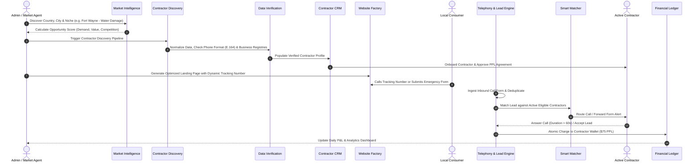

# GLOBALLEAD AI - SYSTEM ARCHITECTURE DOCUMENTATION

## 1. Executive Summary
**GlobalLead AI** is an enterprise-grade, multi-tenant Pay-Per-Lead (PPL), call arbitrage, and local service lead generation platform. It is engineered with a **Hybrid Cloud + Self-Hosted Rocky Linux** architecture to ensure minimum operating cost, maximum data sovereignty, high compute scalability, and strict security isolation.

---

## 2. Hybrid Architecture Topology

```mermaid
flowchart TB
    subgraph PublicInternet["Public Internet & Inbound Traffic"]
        Consumer["Prospective Customers<br/>(Calls / Forms)"]
        ContractorClient["Contractors / Partners<br/>(Mobile & Web)"]
        AdminStaff["Operations & Admin Team"]
    end

    subgraph CloudControlPlane["Cloud Control Plane (Public / Secured Perimeter)"]
        LB["TLS Reverse Proxy / CDN (Nginx / Cloudflare)"]
        AdminWeb["Next.js Admin Command Center<br/>(Port 3000)"]
        ContractorWeb["Contractor Portal<br/>(Port 3001)"]
        LandingSites["Dynamic Website Factory Sites<br/>(Edge Hosted)"]
        
        API["FastAPI Master API Gateway<br/>(Port 8000)"]
        AuthSvc["Auth & RBAC Service (JWT / Sessions)"]
        BillingSvc["Financial Engine & Double-Entry Ledger"]
        LeadRouter["Lead Ingestion & Qualification Engine"]
        TelephonyIn["Inbound Telephony Webhooks<br/>(Twilio / Telnyx)"]
        
        CloudDB[(Primary PostgreSQL 16 + PostGIS)]
        CloudRedis[(Redis Cache & Event Bus)]
    end

    subgraph SelfHostedPlane["Self-Hosted Execution Plane (RHEL / Rocky Linux 9)"]
        WorkerGateway["Worker Gateway (mTLS / Outbound Pull)"]
        DiscoveryWorker["Contractor Discovery Worker"]
        VerificationWorker["Phone & Business Verification Worker"]
        MarketWorker["Market & Keyword Intelligence Worker"]
        SEOWorker["SEO Crawler & Audit Worker"]
        AIAgentOrchestrator["17 Autonomous AI Agents Subsystem"]
        ReportWorker["Daily Financial & Analytics Rollup Worker"]
        WorkerRedis[(Internal Work Queue Redis)]
    end

    Consumer -->|Calls / Forms| LandingSites
    Consumer -->|Phone Calls| TelephonyIn
    LandingSites -->|Form Ingestion| API
    TelephonyIn -->|Call Events| API
    AdminStaff -->|HTTPS| AdminWeb
    ContractorClient -->|HTTPS| ContractorWeb
    AdminWeb -->|REST / JSON| API
    ContractorWeb -->|REST / JSON| API

    API --> CloudDB
    API --> CloudRedis
    API --> LeadRouter
    API --> BillingSvc
    API --> AuthSvc

    CloudRedis -.->|Encrypted Event Queue| WorkerGateway
    WorkerGateway --> MarketWorker
    WorkerGateway --> DiscoveryWorker
    WorkerGateway --> VerificationWorker
    WorkerGateway --> SEOWorker
    WorkerGateway --> AIAgentOrchestrator
    WorkerGateway --> ReportWorker

    AIAgentOrchestrator -->|Outbound REST (Results)| API
    DiscoveryWorker -->|Normalized Batch Writes| API
```

---

## 3. Core Planes Definition

### 3.1 Cloud Control Plane
- **Primary Function:** Ingests user traffic, hosts the public landing pages, receives inbound calls and contact forms, handles user authentication, exposes the administrative command center, executes financial ledger updates, and stores master relational records.
- **Network Policy:** Only ports 80/443 are exposed publicly. PostgreSQL and Redis do NOT accept external incoming traffic; they only listen to internal private networks.

### 3.2 Self-Hosted Execution Plane (RHEL / Rocky Linux 9)
- **Primary Function:** High-compute, resource-intensive scraping, verification, background audits, scheduled market research, and autonomous AI agent operations.
- **Security Rule:** Self-hosted execution nodes initiate **outbound-only** connections to the Cloud Control Plane via authenticated REST APIs with mutual TLS (mTLS) or signed service tokens. No public inbound ports are opened on the Rocky Linux host.

---

## 4. End-to-End Business Lifecycle Flow



---

## 5. Subsystem Specifications

### 5.1 Global Market Intelligence Engine
- Maintains geographical hierarchies: `Country -> State/Province -> City -> Postal Codes -> Service Areas`.
- Multi-factor Opportunity Scoring Engine:
  $$\text{Score} = (0.20 \times \text{Demand}) + (0.20 \times \text{Value}) + (0.15 \times \text{Contractors}) + (0.15 \times \text{Competition}) + (0.15 \times \text{CAC}) + (0.10 \times \text{Stability}) + (0.05 \times \text{Confidence})$$

### 5.2 Automated Contractor Discovery & Verification Engine
- Pluggable connectors: Google Places API, OpenStreetMap (Nominatim/Overpass), Bing Maps API, Public Business Registries.
- International E.164 phone normalization via `phonenumbers` library.
- Multi-tier verification status:
  1. `NOT_AVAILABLE`
  2. `DISCOVERED`
  3. `FORMAT_VALID`
  4. `PROVIDER_VALIDATED`
  5. `REACHABILITY_CHECKED`
  6. `BUSINESS_CONFIRMED`
  7. `FAILED_VERIFICATION`

### 5.3 Smart Lead Matching Engine
- Deterministic routing algorithm factoring:
  1. Service niche match
  2. Spatial containment (PostGIS polygon / radius containment)
  3. Active pricing agreement status
  4. Working hours / emergency availability
  5. Current wallet balance sufficiency
  6. Historical acceptance & dispute score
  7. Capacity cap per day/week

### 5.4 Double-Entry Financial Engine
- Append-only immutable ledger: every financial event is represented by balanced debits and credits.
- Row-level locking (`SELECT ... FOR UPDATE`) during wallet deductions to strictly prevent race conditions and double charges.
- Idempotency keys enforced on all billing transactions.

### 5.5 AI Agent Orchestration Framework
- 17 isolated AI Agents with strict JSON Schema input/output validation.
- Emergency Kill Switch: Any administrator can halt autonomous agent execution instantly via an in-memory/Redis kill-switch flag.
