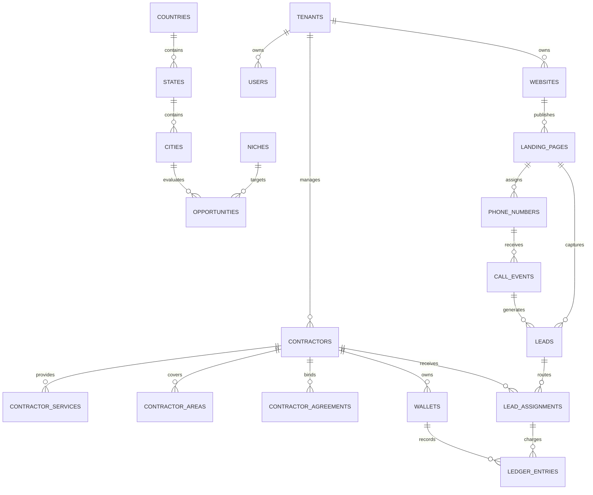

# GLOBALLEAD AI - DATABASE ARCHITECTURE & SCHEMA SPECIFICATION

## 1. Engine & Extensions
- **Primary RDBMS:** PostgreSQL 16
- **Spatial Extension:** PostGIS (`postgis`) for coordinate geometries, service polygons, and radius queries.
- **UUID Extension:** `uuid-ossp` or `pgcrypto` for cryptographically secure UUIDv4 primary keys.
- **Local Dev / Standalone Fallback:** SQLite with spatial distance math fallback.

---

## 2. Entity-Relationship Diagram (ERD)



---

## 3. Detailed Schema Specifications

### 3.1 Identity & Access Management (IAM)

```sql
-- Tenants (Multi-tenant SaaS boundary)
CREATE TABLE tenants (
    id UUID PRIMARY KEY DEFAULT gen_random_uuid(),
    name VARCHAR(255) NOT NULL,
    slug VARCHAR(100) UNIQUE NOT NULL,
    plan VARCHAR(50) NOT NULL DEFAULT 'standard',
    status VARCHAR(50) NOT NULL DEFAULT 'active',
    settings JSONB DEFAULT '{}',
    created_at TIMESTAMPTZ NOT NULL DEFAULT NOW(),
    updated_at TIMESTAMPTZ NOT NULL DEFAULT NOW()
);

-- Users
CREATE TABLE users (
    id UUID PRIMARY KEY DEFAULT gen_random_uuid(),
    tenant_id UUID REFERENCES tenants(id) ON DELETE CASCADE,
    email VARCHAR(255) UNIQUE NOT NULL,
    hashed_password VARCHAR(255) NOT NULL,
    full_name VARCHAR(255) NOT NULL,
    role VARCHAR(50) NOT NULL DEFAULT 'admin', -- 'super_admin', 'admin', 'analyst', 'contractor'
    contractor_id UUID, -- If contractor role
    is_active BOOLEAN NOT NULL DEFAULT TRUE,
    last_login_at TIMESTAMPTZ,
    created_at TIMESTAMPTZ NOT NULL DEFAULT NOW(),
    updated_at TIMESTAMPTZ NOT NULL DEFAULT NOW()
);
```

### 3.2 Geography & Market Intelligence

```sql
-- Countries
CREATE TABLE countries (
    id UUID PRIMARY KEY DEFAULT gen_random_uuid(),
    code VARCHAR(2) UNIQUE NOT NULL, -- US, GB, CA, AU, DE, etc.
    name VARCHAR(100) NOT NULL,
    currency VARCHAR(3) NOT NULL DEFAULT 'USD',
    phone_prefix VARCHAR(10) NOT NULL,
    is_active BOOLEAN NOT NULL DEFAULT TRUE,
    created_at TIMESTAMPTZ NOT NULL DEFAULT NOW()
);

-- States / Provinces
CREATE TABLE states (
    id UUID PRIMARY KEY DEFAULT gen_random_uuid(),
    country_id UUID NOT NULL REFERENCES countries(id) ON DELETE CASCADE,
    code VARCHAR(10) NOT NULL,
    name VARCHAR(100) NOT NULL,
    created_at TIMESTAMPTZ NOT NULL DEFAULT NOW(),
    UNIQUE(country_id, code)
);

-- Cities
CREATE TABLE cities (
    id UUID PRIMARY KEY DEFAULT gen_random_uuid(),
    state_id UUID NOT NULL REFERENCES states(id) ON DELETE CASCADE,
    name VARCHAR(150) NOT NULL,
    latitude NUMERIC(10, 7),
    longitude NUMERIC(10, 7),
    population INTEGER DEFAULT 0,
    median_income NUMERIC(12, 2) DEFAULT 0,
    homeownership_rate NUMERIC(5, 2) DEFAULT 0,
    is_active BOOLEAN NOT NULL DEFAULT TRUE,
    created_at TIMESTAMPTZ NOT NULL DEFAULT NOW()
);

-- Niches (High-value home & commercial services)
CREATE TABLE niches (
    id UUID PRIMARY KEY DEFAULT gen_random_uuid(),
    name VARCHAR(150) UNIQUE NOT NULL, -- e.g. "Water Damage Restoration"
    slug VARCHAR(150) UNIQUE NOT NULL,
    avg_lead_value NUMERIC(10, 2) NOT NULL DEFAULT 50.00,
    emergency_level VARCHAR(20) DEFAULT 'high', -- 'critical', 'high', 'medium', 'low'
    description TEXT,
    is_active BOOLEAN NOT NULL DEFAULT TRUE,
    created_at TIMESTAMPTZ NOT NULL DEFAULT NOW()
);

-- Market Opportunities & Scoring
CREATE TABLE opportunities (
    id UUID PRIMARY KEY DEFAULT gen_random_uuid(),
    city_id UUID NOT NULL REFERENCES cities(id) ON DELETE CASCADE,
    niche_id UUID NOT NULL REFERENCES niches(id) ON DELETE CASCADE,
    demand_score NUMERIC(5, 2) NOT NULL DEFAULT 0.0,
    commercial_value_score NUMERIC(5, 2) NOT NULL DEFAULT 0.0,
    contractor_availability_score NUMERIC(5, 2) NOT NULL DEFAULT 0.0,
    competition_score NUMERIC(5, 2) NOT NULL DEFAULT 0.0,
    cac_score NUMERIC(5, 2) NOT NULL DEFAULT 0.0,
    stability_score NUMERIC(5, 2) NOT NULL DEFAULT 0.0,
    confidence_score NUMERIC(5, 2) NOT NULL DEFAULT 0.0,
    overall_score NUMERIC(5, 2) NOT NULL DEFAULT 0.0,
    status VARCHAR(50) NOT NULL DEFAULT 'discovered', -- 'discovered', 'researching', 'viable', 'activated', 'paused'
    metrics_data JSONB DEFAULT '{}',
    created_at TIMESTAMPTZ NOT NULL DEFAULT NOW(),
    updated_at TIMESTAMPTZ NOT NULL DEFAULT NOW(),
    UNIQUE(city_id, niche_id)
);
```

### 3.3 Contractor Operations & CRM

```sql
-- Contractors
CREATE TABLE contractors (
    id UUID PRIMARY KEY DEFAULT gen_random_uuid(),
    tenant_id UUID REFERENCES tenants(id) ON DELETE CASCADE,
    business_name VARCHAR(255) NOT NULL,
    owner_name VARCHAR(255),
    primary_phone VARCHAR(50) NOT NULL,
    secondary_phone VARCHAR(50),
    email VARCHAR(255),
    website VARCHAR(255),
    address VARCHAR(255),
    city VARCHAR(150) NOT NULL,
    state VARCHAR(50) NOT NULL,
    country VARCHAR(10) NOT NULL DEFAULT 'US',
    postal_code VARCHAR(20),
    latitude NUMERIC(10, 7),
    longitude NUMERIC(10, 7),
    rating NUMERIC(3, 2) DEFAULT 0.0,
    review_count INTEGER DEFAULT 0,
    verification_status VARCHAR(50) NOT NULL DEFAULT 'DISCOVERED',
    verification_notes TEXT,
    partner_status VARCHAR(50) NOT NULL DEFAULT 'PROSPECT', -- 'PROSPECT', 'CONTACTED', 'ACTIVE', 'PAUSED', 'REJECTED'
    discovery_source VARCHAR(100) DEFAULT 'GOOGLE_PLACES',
    created_at TIMESTAMPTZ NOT NULL DEFAULT NOW(),
    updated_at TIMESTAMPTZ NOT NULL DEFAULT NOW()
);

-- Contractor Pricing & Service Agreements
CREATE TABLE contractor_agreements (
    id UUID PRIMARY KEY DEFAULT gen_random_uuid(),
    contractor_id UUID NOT NULL REFERENCES contractors(id) ON DELETE CASCADE,
    niche_id UUID NOT NULL REFERENCES niches(id) ON DELETE CASCADE,
    lead_type VARCHAR(50) NOT NULL DEFAULT 'EXCLUSIVE_CALL', -- 'EXCLUSIVE_CALL', 'SHARED_CALL', 'FORM_LEAD'
    price_per_lead NUMERIC(10, 2) NOT NULL DEFAULT 75.00,
    min_call_duration_seconds INTEGER NOT NULL DEFAULT 60,
    auto_recharge_threshold NUMERIC(10, 2) DEFAULT 100.00,
    auto_recharge_amount NUMERIC(10, 2) DEFAULT 500.00,
    is_active BOOLEAN NOT NULL DEFAULT TRUE,
    valid_from DATE NOT NULL DEFAULT CURRENT_DATE,
    valid_until DATE,
    created_at TIMESTAMPTZ NOT NULL DEFAULT NOW()
);
```

### 3.4 Telephony, Landing Pages & Leads

```sql
-- Websites & Landing Pages
CREATE TABLE websites (
    id UUID PRIMARY KEY DEFAULT gen_random_uuid(),
    tenant_id UUID REFERENCES tenants(id) ON DELETE CASCADE,
    domain VARCHAR(255) UNIQUE NOT NULL,
    title VARCHAR(255) NOT NULL,
    theme_config JSONB DEFAULT '{}',
    is_published BOOLEAN NOT NULL DEFAULT FALSE,
    created_at TIMESTAMPTZ NOT NULL DEFAULT NOW()
);

CREATE TABLE landing_pages (
    id UUID PRIMARY KEY DEFAULT gen_random_uuid(),
    website_id UUID NOT NULL REFERENCES websites(id) ON DELETE CASCADE,
    city_id UUID NOT NULL REFERENCES cities(id) ON DELETE CASCADE,
    niche_id UUID NOT NULL REFERENCES niches(id) ON DELETE CASCADE,
    slug VARCHAR(255) NOT NULL,
    headline VARCHAR(255) NOT NULL,
    content_body TEXT NOT NULL,
    seo_title VARCHAR(255),
    seo_description TEXT,
    tracking_phone VARCHAR(50),
    is_active BOOLEAN NOT NULL DEFAULT TRUE,
    created_at TIMESTAMPTZ NOT NULL DEFAULT NOW(),
    UNIQUE(website_id, slug)
);

-- Phone Numbers
CREATE TABLE phone_numbers (
    id UUID PRIMARY KEY DEFAULT gen_random_uuid(),
    phone_number VARCHAR(50) UNIQUE NOT NULL,
    provider VARCHAR(50) NOT NULL DEFAULT 'TWILIO', -- 'TWILIO', 'TELNYX'
    landing_page_id UUID REFERENCES landing_pages(id),
    status VARCHAR(50) NOT NULL DEFAULT 'ACTIVE',
    monthly_cost NUMERIC(6, 2) DEFAULT 1.00,
    created_at TIMESTAMPTZ NOT NULL DEFAULT NOW()
);

-- Leads
CREATE TABLE leads (
    id UUID PRIMARY KEY DEFAULT gen_random_uuid(),
    tenant_id UUID REFERENCES tenants(id) ON DELETE CASCADE,
    niche_id UUID NOT NULL REFERENCES niches(id),
    city_id UUID NOT NULL REFERENCES cities(id),
    customer_name VARCHAR(255),
    customer_phone VARCHAR(50) NOT NULL,
    customer_email VARCHAR(255),
    lead_source VARCHAR(50) NOT NULL DEFAULT 'PHONE_CALL', -- 'PHONE_CALL', 'WEB_FORM'
    qualification_status VARCHAR(50) NOT NULL DEFAULT 'NEW', -- 'NEW', 'QUALIFIED', 'SPAM', 'DUPLICATE', 'REJECTED'
    details TEXT,
    created_at TIMESTAMPTZ NOT NULL DEFAULT NOW()
);

-- Lead Assignments & Delivery
CREATE TABLE lead_assignments (
    id UUID PRIMARY KEY DEFAULT gen_random_uuid(),
    lead_id UUID NOT NULL REFERENCES leads(id) ON DELETE CASCADE,
    contractor_id UUID NOT NULL REFERENCES contractors(id) ON DELETE CASCADE,
    agreement_id UUID REFERENCES contractor_agreements(id),
    delivery_status VARCHAR(50) NOT NULL DEFAULT 'DELIVERED', -- 'DELIVERED', 'ACCEPTED', 'DISPUTED', 'REFUNDED'
    charged_amount NUMERIC(10, 2) NOT NULL DEFAULT 0.0,
    delivered_at TIMESTAMPTZ NOT NULL DEFAULT NOW()
);
```

### 3.5 Financial Ledger & Double-Entry Accounting

```sql
-- Contractor Wallets
CREATE TABLE wallets (
    id UUID PRIMARY KEY DEFAULT gen_random_uuid(),
    contractor_id UUID UNIQUE NOT NULL REFERENCES contractors(id) ON DELETE CASCADE,
    currency VARCHAR(3) NOT NULL DEFAULT 'USD',
    balance NUMERIC(12, 2) NOT NULL DEFAULT 0.00,
    reserved_balance NUMERIC(12, 2) NOT NULL DEFAULT 0.00,
    version INTEGER NOT NULL DEFAULT 1, -- Optimistic locking
    created_at TIMESTAMPTZ NOT NULL DEFAULT NOW(),
    updated_at TIMESTAMPTZ NOT NULL DEFAULT NOW()
);

-- Immutable Ledger Entries
CREATE TABLE ledger_entries (
    id UUID PRIMARY KEY DEFAULT gen_random_uuid(),
    wallet_id UUID NOT NULL REFERENCES wallets(id) ON DELETE RESTRICT,
    assignment_id UUID REFERENCES lead_assignments(id),
    entry_type VARCHAR(50) NOT NULL, -- 'PREPAID_DEPOSIT', 'LEAD_CHARGE', 'REFUND', 'ADJUSTMENT'
    amount NUMERIC(12, 2) NOT NULL, -- Negative for deductions, positive for credits
    balance_after NUMERIC(12, 2) NOT NULL,
    description TEXT NOT NULL,
    idempotency_key VARCHAR(255) UNIQUE NOT NULL,
    created_at TIMESTAMPTZ NOT NULL DEFAULT NOW()
);
```

### 3.6 Autonomous AI Agents & System Execution

```sql
-- AI Agents
CREATE TABLE agents (
    id UUID PRIMARY KEY DEFAULT gen_random_uuid(),
    name VARCHAR(100) UNIQUE NOT NULL,
    purpose TEXT NOT NULL,
    model_name VARCHAR(100) NOT NULL DEFAULT 'gemini-1.5-flash',
    is_active BOOLEAN NOT NULL DEFAULT TRUE,
    created_at TIMESTAMPTZ NOT NULL DEFAULT NOW()
);

-- Agent Execution Runs
CREATE TABLE agent_runs (
    id UUID PRIMARY KEY DEFAULT gen_random_uuid(),
    agent_id UUID NOT NULL REFERENCES agents(id) ON DELETE CASCADE,
    status VARCHAR(50) NOT NULL DEFAULT 'RUNNING', -- 'RUNNING', 'COMPLETED', 'FAILED'
    input_payload JSONB NOT NULL,
    output_payload JSONB,
    tokens_consumed INTEGER DEFAULT 0,
    cost_usd NUMERIC(8, 4) DEFAULT 0.0,
    error_message TEXT,
    started_at TIMESTAMPTZ NOT NULL DEFAULT NOW(),
    completed_at TIMESTAMPTZ
);
```
